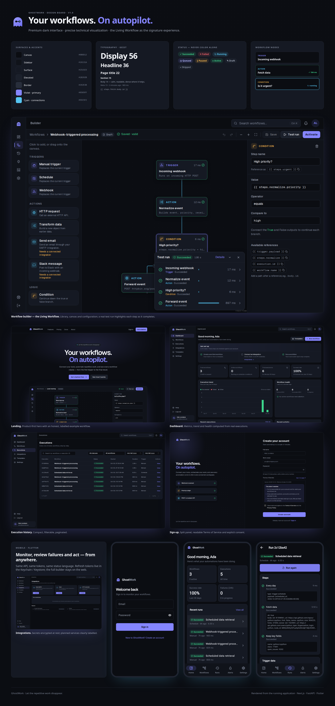

# GhostWork

**Your workflows. On autopilot.**



*Design board rendered from the running app: brand, tokens, status system, web and mobile screens
(`docs/design/ghostwork-design-board.png`).*

GhostWork is a workflow automation platform built around the **Living Workflow**: the
same canvas you design an automation on shows what it is doing while it runs and
what each step did afterwards.

- **Frontend:** Next.js 16 (App Router), React 19, TypeScript, Tailwind CSS 4, DaisyUI,
  TanStack Query, React Hook Form + Zod, React Flow (`@xyflow/react`), Recharts.
- **Backend:** FastAPI, SQLModel/SQLAlchemy, PostgreSQL, Alembic, Celery + Redis,
  Argon2 (pwdlib), JWT, pytest.
- **Mobile:** Flutter (Android, iOS, web) with Riverpod, go_router and secure token storage.
- **Infrastructure:** Docker Compose (PostgreSQL, Redis, Mailpit; optional app containers), GitHub Actions CI.

---

## What works today

| Area | Status |
| --- | --- |
| Accounts | Register (with Terms of Service acceptance, versioned and recorded), sign in/out, Argon2 hashing, password change, password reset by email, email change, account deletion |
| Sessions | 15-min access tokens + rotating refresh sessions (HttpOnly cookie), reuse detection, per-device revocation, CSRF guard |
| Workflows | Create, list (search/filter/sort/paginate), edit, duplicate, activate/pause, delete, JSON export/import, ownership enforced server-side |
| Builder | Drag/click to add steps, connect, configure, rename, delete, undo/redo, save (Ctrl S), validation with per-step issues, activation confirm, unsaved-change protection, live test runs |
| Triggers | Manual, schedule (≥ 5 min), webhook (secret URL, regenerable, optional HMAC-SHA256 signatures) |
| Steps | HTTP request (SSRF-guarded, retries, timeouts), transform, condition (true/false branches), email via SMTP, Slack incoming webhook |
| Execution | Celery worker, per-step records (status, attempts, output, error, timing), cancellation, re-run, time limits, stale-run reaper, per-user concurrency limit, 90-day retention |
| Monitoring | Dashboard metrics from real data, 14-day trend, health summary, execution history with filters, notifications |
| Integrations | SMTP, Slack, HTTP credentials — secrets encrypted with Fernet, never returned |
| Templates | 5 templates, all valid against the implemented step types |
| Settings | Profile, email, password, sessions, notification and appearance preferences, activity log, account deletion |
| Mobile app | Every web feature natively in Flutter: public pages, auth and recovery, dashboard, workflow management, touch builder, executions, integrations, templates, settings, help |

**Not implemented (shown as "Planned" in the UI):** Google Workspace and GitHub
integrations, team workspaces, billing, push notifications.

GhostWork has **not** been hardened or load-tested for production use; see
[Production checklist](#production-checklist).

---

## Local development

Prerequisites: Docker, Node.js 22+, Python 3.12+ (the existing venv uses 3.14).

### 1. Infrastructure

```bash
cp .env.example .env                # first time only; set POSTGRES_PASSWORD
docker compose up -d                # PostgreSQL :5434, Redis :6380, Mailpit :1026 / UI :8026
```

### 2. Backend

```bash
cd backend
cp .env.example .env                # first time only; fill JWT_SECRET_KEY, INTEGRATION_ENCRYPTION_KEY,
                                    # and make DATABASE_URL's password match the root .env
python -m venv .venv                # only if .venv doesn't exist
.venv/bin/pip install -r requirements.txt
.venv/bin/alembic upgrade head

# three terminals:
.venv/bin/uvicorn app.main:app --reload --port 8000
.venv/bin/celery -A app.workers.celery_app worker --loglevel=info
.venv/bin/celery -A app.workers.celery_app beat --loglevel=info
```

API docs: <http://localhost:8000/docs>

### 3. Frontend

```bash
cd frontend
cp .env.example .env.local          # NEXT_PUBLIC_API_BASE_URL=http://localhost:8000
npm install
npm run dev                         # http://localhost:3000
```

### 4. Mobile app (Flutter)

Flutter is installed at `~/development/flutter` (add `~/development/flutter/bin` to your `PATH`).

```bash
cd mobile
flutter pub get
flutter test && flutter analyze

# In Chrome (no Android/iOS tooling needed). Port 8090 is in the dev CORS allow-list.
flutter run -d chrome --web-port 8090 --dart-define=API_BASE_URL=http://localhost:8000

# Android emulator (needs Android Studio + SDK): the host machine is 10.0.2.2
flutter run --dart-define=API_BASE_URL=http://10.0.2.2:8000 --dart-define=WEB_APP_URL=http://10.0.2.2:3000
```

iOS builds require macOS with Xcode. Release builds should point `API_BASE_URL` at your HTTPS API.

### Everything in containers (optional)

```bash
docker compose --profile full up --build
```

Runs the API (applies migrations on start), worker, beat and the production web build.
Stop any locally running API/web servers first (ports 8000 and 3000).

---

## Testing

```bash
# Backend: 59 tests against a real PostgreSQL test database (ghostwork_test)
docker exec ghostwork-db psql -U ghostwork -d ghostwork -c "CREATE DATABASE ghostwork_test OWNER ghostwork;"  # once
cd backend && .venv/bin/pytest -q

# Frontend: type check, lint, production build
cd frontend && npm run typecheck && npm run lint && npm run build

# End-to-end (Playwright) — needs the API and a Celery worker running
cd frontend && npx playwright install chromium   # once
npm run test:e2e                                  # 15 tests (desktop + mobile viewport)

# Mobile: 28 tests (models, API client auth flow, builder logic, redirects, widgets, sign-in flow)
cd mobile && flutter test
```

CI (`.github/workflows/ci.yml`) runs the backend tests with migration checks and the
frontend type check, lint and build on every push and pull request.

The e2e suite registers fresh accounts, so the development `backend/.env` raises
`REGISTER_RATE_LIMIT_PER_HOUR`. Production keeps the defaults (5/hour, 10 logins/5 min).

---

## Architecture

```
frontend/                         Next.js App Router
  src/app/(marketing)/            Public site: /, /features, /pricing, /docs, /about, /privacy, /terms
  src/app/(auth)/                 /login, /register, /forgot-password, /reset-password
  src/app/(app)/                  Authenticated app (client-gated): dashboard, workflows, builder,
                                  executions, integrations, templates, settings, help
  src/components/ui/              Design-system primitives (Button, Field, Dialog, Drawer, Menu, Tabs, Toast…)
  src/components/workflow/        Living Workflow canvas: node, edge, read-only canvas, auto-fit
  src/components/builder/         Builder: library, config panel, editor
  src/lib/                        Typed API client, auth provider, TanStack Query hooks, types
  e2e/                            Playwright tests

backend/
  app/api/routes/                 HTTP layer only (auth, users, workflows, executions, hooks,
                                  dashboard, integrations, catalog, notifications)
  app/services/                   Business logic: auth, workflow definition & validation,
                                  execution engine, integrations, SSRF guard, templating, mailer
  app/workers/                    Celery app, run/schedule/reaper tasks
  app/models/                     SQLModel tables
  migrations/                     Alembic
  tests/                          pytest
```

FastAPI is the single source of business rules. The Next.js app holds no business
logic beyond client-side form validation that mirrors the API.

### Auth model

- `POST /auth/login` returns a 15-minute JWT access token (kept in memory) and sets an
  HttpOnly `gw_refresh` cookie scoped to `/api/v1/auth`.
- `POST /auth/refresh` rotates the refresh token. Presenting an already-rotated token
  after a 20-second grace window revokes that session (theft detection).
- Access tokens carry the session ID; every request checks the session is still active,
  so revocation is immediate.
- Cookie-authenticated endpoints require the `X-GhostWork-CSRF` header and an allowed
  `Origin`. Mobile clients send `client: "mobile"` and receive the refresh token in the
  body instead of a cookie.

### Workflow definitions

```json
{
  "nodes": [{ "id": "fetch", "type": "action.http_request", "name": "Fetch", "position": {"x": 0, "y": 0}, "config": {} }],
  "edges": [{ "id": "e1", "source": "trigger", "target": "fetch", "source_handle": "out" }]
}
```

Saved definitions must be structurally valid. Activation and runs require full
validation (one trigger, reachable DAG, required config, references that resolve,
integrations owned by the user). Runs execute a snapshot, so editing a workflow never
changes past history.

---

## Security notes

- Passwords: Argon2id; constant-time path for unknown accounts.
- Integration secrets: Fernet-encrypted (`INTEGRATION_ENCRYPTION_KEY`); never returned
  by the API, never written to step outputs or logs.
- Outbound HTTP: http/https only, no credentials in URLs, DNS resolved and checked
  against private/loopback/link-local/reserved ranges, connection pinned to the checked
  IP (with SNI), redirects re-checked, 1 MB / 30 s caps.
- No user code execution: steps are a fixed catalog; templating is dotted lookups only.
- Webhooks: 256 KB limit, 60 requests/minute per URL, auth/cookie headers dropped.
- Errors: unhandled exceptions return a generic 500; details stay in server logs.
- Rate limits (Redis): register, login, refresh, password reset.

### Production checklist

Before exposing GhostWork publicly:

- [ ] `ENVIRONMENT=production` (forces Secure cookies; refuses private-network requests)
- [ ] Strong `JWT_SECRET_KEY` and `INTEGRATION_ENCRYPTION_KEY` from a secret manager; plan key rotation
- [ ] HTTPS everywhere; set `CORS_ORIGINS`, `FRONTEND_URL`, `API_PUBLIC_URL`
- [ ] Real SMTP provider for platform email
- [ ] Managed PostgreSQL backups and Redis persistence
- [ ] Monitoring/alerting for the worker and beat processes
- [ ] Load and security testing

---

## Mobile (Flutter)

`mobile/` is a native Flutter app with the same features, screens, routes and wording as the
web app, including the visual builder (drag to move, drag between handles to connect, pinch to
zoom). It uses the API's mobile auth mode: the refresh token travels in the request body, is
stored in the Keychain/Keystore and rotates on every refresh. See
[`docs/mobile-flutter.md`](docs/mobile-flutter.md).

The Terms text lives in `frontend/src/lib/terms.json`. After editing it, run
`scripts/sync-shared.sh` to copy it to the mobile app; CI fails if the copies differ.

## Legal

The Terms of Service (`frontend/src/lib/terms.ts`, shown at `/terms` and during sign-up) and
Privacy page are written in plain language for GhostWork's actual behavior. They have not
been reviewed by a lawyer; have them reviewed before offering GhostWork to the public, and
bump `TERMS_VERSION` (frontend and `backend/app/core/config.py`) whenever they change.
